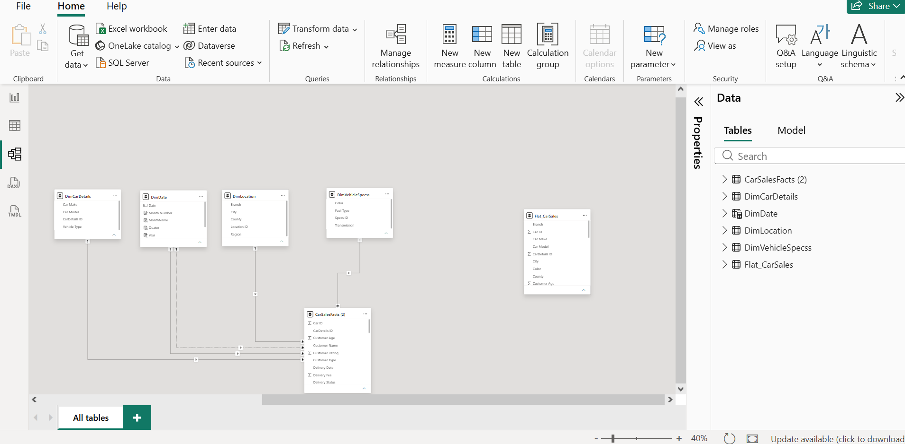
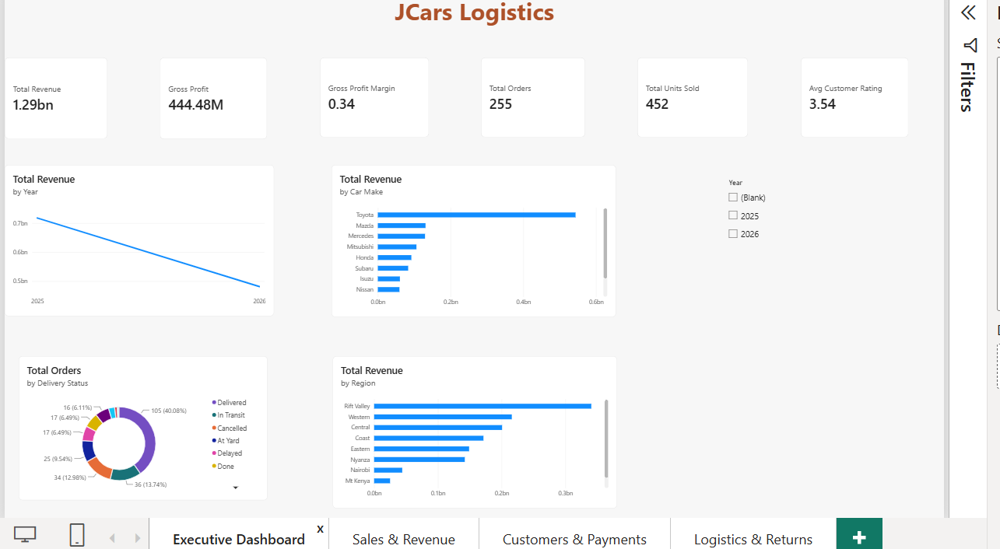
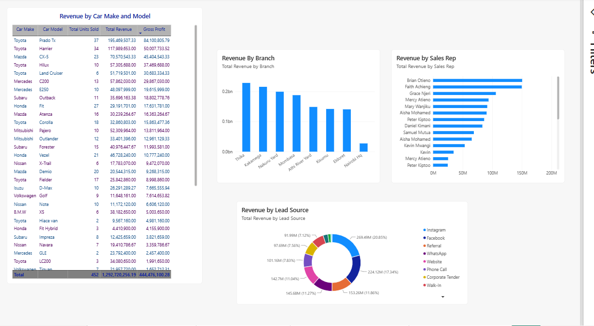
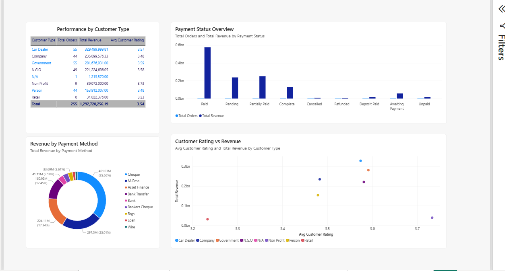
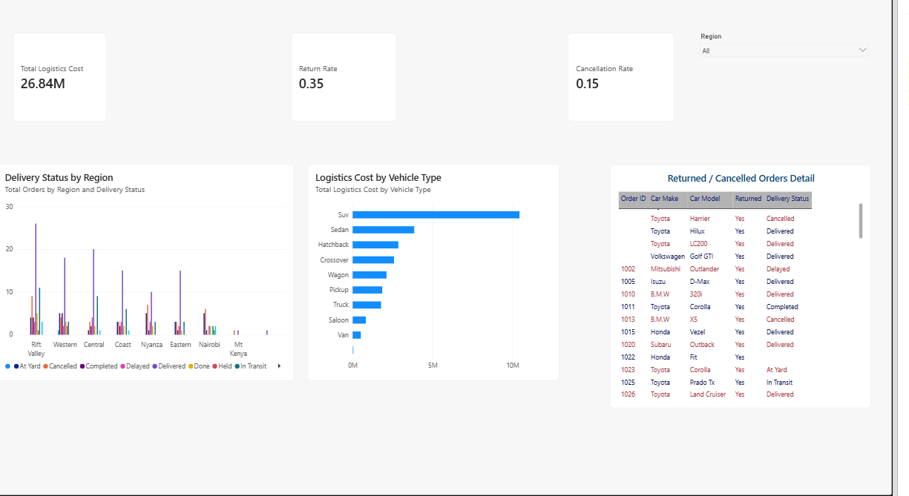

# JCars Logistics Power BI Business Intelligence Project

## Project Objective

This project transforms a raw, messy dataset from JCars Logistics into a reliable, interactive Power BI solution that enables management to understand sales performance, profitability, vehicle and branch performance, customer behavior, logistics efficiency, and areas requiring further investigation.

## Dataset

The raw dataset (`Jcars_data.csv`) contains vehicle sales transaction records. Each row represents one sales order, capturing customer details, vehicle details, pricing, discounts, delivery, payment, and logistics information. The dataset required significant cleaning before it was suitable for analysis.

## Data Quality Audit

A full data quality audit was conducted, identifying atleast 6 significant issues, including:

- Negative and invalid (>100%) Discount values
- Revenue Recorded blank despite confirmed "Paid" payment status

- Residual unexplained revenue discrepancy (~KES 468.51M)
- Duplicate Order IDs

- Invalid Customer Rating values outside the 1–5 scale
- An implausible Customer Age outlier (121 years)

Full details, reasoning, and handling decisions for each issue are documented in `/docs/data_quality_audit.md`.

## Currency Standardization

The dataset contained monetary values in multiple currencies (KES, USD, EUR, ZAR). Due to a data cleaning limitation, currency identifiers were removed before conversion rates could be applied to differentiate rows. All monetary values are therefore treated as KES, per the assessment's default assumption. This is documented as a known limitation — see `/docs/assumptions.md`.

## Data Cleaning & Preparation

Cleaning was performed using Power Query and included: trimming and standardizing text fields, correcting data types, fixing invalid Discount values, recalculating missing Revenue Recorded values for Paid transactions, and resolving relationship issues in the data model.

## Data Model

The project uses a star schema:

- **Fact table:** CarSalesFacts
- **Dimension tables:** DimCarDetails, DimLocation, DimVehicleSpecs, DimDate

All dimension-to-fact relationships are one-to-many with single-direction cross-filtering. DimDate includes two relationships to CarSalesFacts (Order Date — active; Delivery Date — inactive, used via `USERELATIONSHIP` in specific measures).

## Key DAX Measures

- `Total Revenue`, `Total Cost`, `Gross Profit`, `Gross Profit Margin`
- `Total Orders`, `Total Units Sold`, `Avg Order Value`
- `Return Rate`, `Cancellation Rate`, `Avg Customer Rating`
- `Revenue YoY %` (time intelligence using DimDate)
- Validation measures: `Revenue Check (Calculated)`, `Revenue Discrepancy`

## Executive Dashboard

Page 1 provides a one-page management overview: KPI cards (Revenue, Gross Profit, Margin, Orders, Units Sold, Avg Rating), a revenue trend by year, revenue by car make, revenue by region, and order status breakdown.

## Detailed Report Pages

- **Sales & Revenue:** Revenue by car make/model, branch, sales rep, and lead source

- **Customers & Payments:** Performance by customer type, payment method, payment status, and rating-vs-revenue relationship

- **Logistics & Returns:** Logistics cost, return/cancellation rates, delivery status by region, and a returned/cancelled orders detail table

## Key Insights

1. Order volume declined from 158 orders (2025) to 75 orders (2026), despite full-year data coverage.
2. Toyota dominates vehicle revenue performance, led by the Prado TX (KES 195.5M).
3. Thika branch outperforms all others; Nairobi HQ underperforms despite its market size.
4. SUVs carry the highest logistics cost among all vehicle types.
5. Data quality issues (invalid discounts, missing revenue on paid orders) materially affected reported figures before correction.

## Recommendations

1. Investigate the 2026 order volume decline, starting with Lead Source and Sales Rep performance.
2. Review Nairobi HQ branch performance given its underperformance relative to smaller branches.
3. Strengthen data entry validation rules for Discount and Revenue Recorded fields to prevent recurring data quality issues.

## Assumptions & Business Rules

See `/docs/assumptions.md` for full documentation of assumptions made throughout the project (currency, revenue, discounts, dates, returns/cancellations, and data model decisions).

## Files in This Repository

- `JCarsLogistics.pbix` — Power BI project file
- `Jcars_data_cleaned.csv` — final analysis-ready dataset
- `/docs/data_quality_audit.md` — full data quality findings
- `/docs/assumptions.md` — assumptions and business rules
- `/screenshots/` — model view, dashboard, and report screenshots
